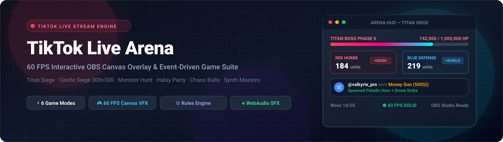
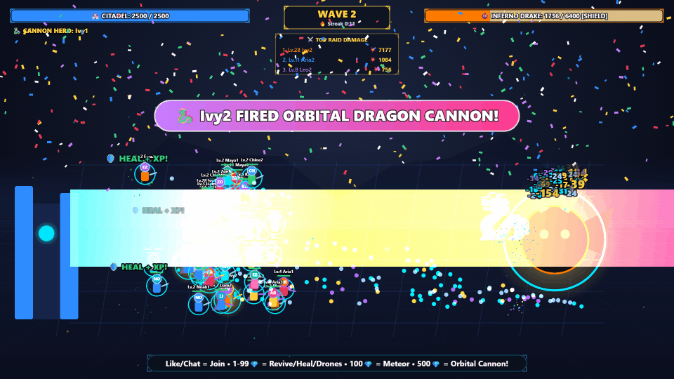
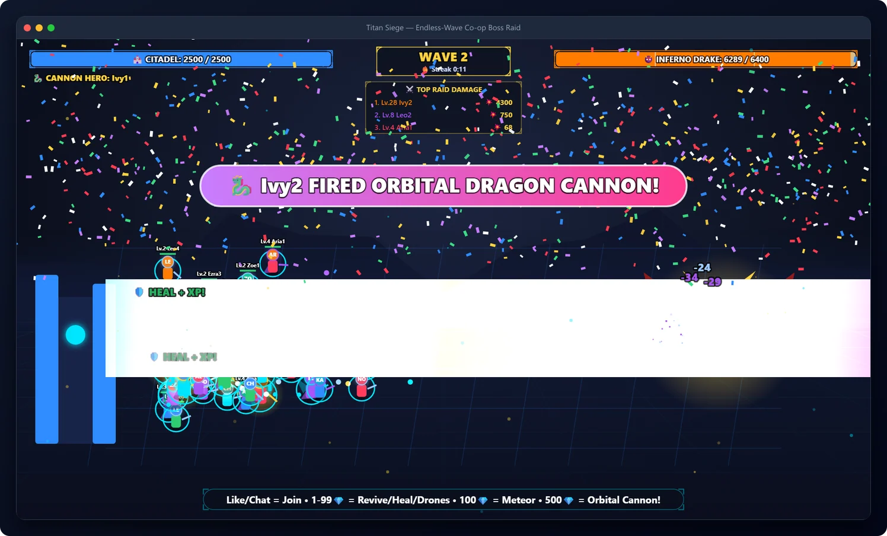
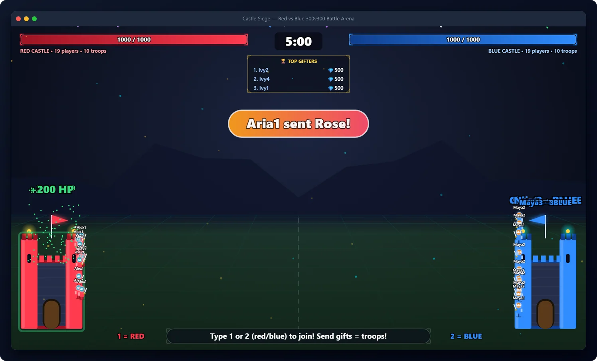
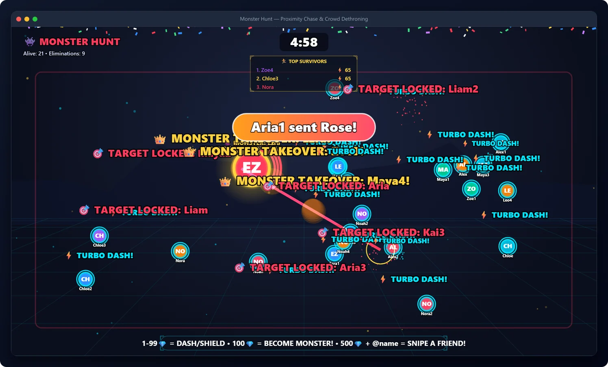
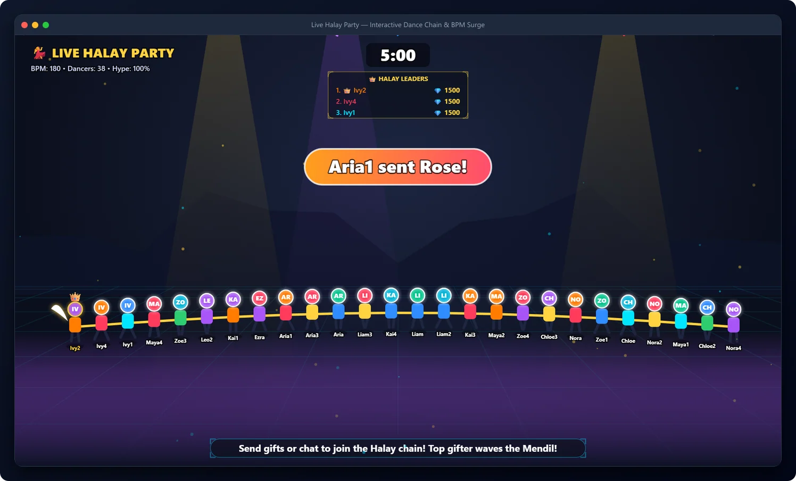
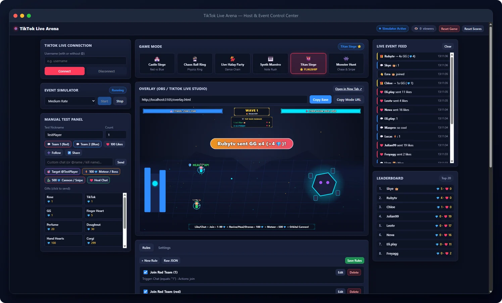
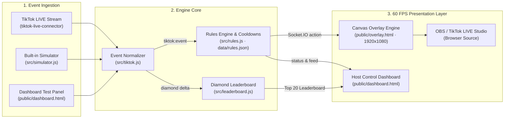

<div align="center">



# TikTok Live Arena

**Interactive TikTok LIVE streaming game suite &amp; 60 FPS real-time Canvas overlay engine for OBS Studio &amp; TikTok LIVE Studio**

[](https://nodejs.org/)
[](https://expressjs.com/)
[](https://socket.io/)
[](public/overlay.html)
[](public/js/overlay.js)
[](LICENSE)

<p align="center">
  <a href="#live-demo">Live Demo</a> •
  <a href="#screenshots">Screenshots</a> •
  <a href="#architecture">Architecture</a> •
  <a href="#6-interactive-game-modes">Game Modes</a> •
  <a href="#psychological-gift-ladder-001--5">Monetization Ladder</a> •
  <a href="#-ai-agent-skill--custom-game-generator-tiktok-live-game-factory">AI Skill &amp; CLI</a> •
  <a href="#quick-start">Quick Start</a> •
  <a href="#obs-studio--tiktok-live-studio-overlay-setup">OBS Setup</a>
</p>

</div>

---

## Live Demo

<div align="center">
  
  <p><em>Real-time 60 FPS gameplay demo showing Titan Siege boss raid, Castle Siege frontline battle, Monster Hunt chase, and the live Socket.IO control dashboard.</em></p>
</div>

---

## Screenshots

<table>
  <tr>
    <td width="50%" align="center">
      <strong>Titan Siege — Endless-Wave Co-op Boss Raid (<code>boss</code>)</strong><br/><br/>
      
    </td>
    <td width="50%" align="center">
      <strong>Castle Siege — Red vs Blue 300v300 Battle (<code>arena</code>)</strong><br/><br/>
      
    </td>
  </tr>
  <tr>
    <td width="50%" align="center">
      <strong>Monster Hunt — Proximity Chase &amp; Dethroning (<code>monster</code>)</strong><br/><br/>
      
    </td>
    <td width="50%" align="center">
      <strong>Live Halay Party — Interactive Dance Chain (<code>halay</code>)</strong><br/><br/>
      
    </td>
  </tr>
  <tr>
    <td colspan="2" align="center">
      <strong>TikTok Live Arena — Host &amp; Event Control Center</strong><br/><br/>
      
    </td>
  </tr>
</table>

---

## Architecture

Every event—whether coming from a live TikTok stream via `@tobiasfrid/tiktok-live-connector`, the built-in stress simulator, or the manual test suite—flows through an identical real-time pipeline:



---

## 6 Interactive Game Modes

Switch modes live on-the-fly from the Control Dashboard or lock a mode via URL query parameters (`?mode=...&submode=...`):

| Mode | Title | Core Gameplay & Retention Hook |
| :--- | :--- | :--- |
| `boss` | **Titan Siege** *(Flagship)* | Endless-wave co-op vs. AI Horde & multi-phase Titan Boss. Persistent hero evolution (*Squire → Knight → Paladin → Mecha*), orbiting drones, telegraphed red laser/meteor threats, and **Betray & Control the Boss** mega-gifts. |
| `monster` | **Monster Hunt** | Psychological chase arena with proximity danger rings (`⚠️ DANGER! Gift = DASH!`), **100💎 Become the Monster** takeover & dethroning, and **500💎 `@name` Targeted Snipe** eliminations. |
| `arena` | **Castle Siege** | Red vs. Blue armies with **Frontline Barrier & Y-Homing** physics so 300v300 armies clash head-on. Includes 3 sub-modes: `frontline`, `lanes` (3 glowing bridges), and `tug` (War Banner payload). |
| `halay` | **Live Halay & Dance Party** | Curved hand-holding avatar dance chain. Top gifter becomes the crowned **Halay Leader** waving a glowing handkerchief (`mendil`), raising BPM and accelerating a WebAudio folk-synth rhythm. |
| `balls` | **Chaos Ball Ring** | Rotating neon ring with gap & obstacle physics. Viewer interactions spawn named bouncing balls scaled by gift value, triggering harmonic WebAudio notes on every bounce. |
| `music` | **Synth Maestro & Note Rush** | Center-stage animated musician with a 48-bar radial visualizer. Viewer events drop named Lead/Bass/Arp/Beat orbs into target rings, building dynamic multi-track melodies. |

---

## Psychological Gift-Ladder (€0.01 – €5+)

Designed for 30–120+ minute stream retention using loss aversion, social status, and spectacle moments (purely in-game entertainment power—no cash prizes or lotteries):

- **Free Engagement (`Chat / Like / Follow / Share`):** Joins teams (`1`/`red`, `2`/`blue`), spawns baseline defenders/survivors, sets `@name` snipe targets, and charges collective bars.
- **Micro-Tier (`1–99💎` / €0.01–€0.99):** **Loss-Aversion Rescues** — Turbo Dash + 4s Shield, Instant Revive, Hero XP & Orbiting Drones, and extra soldiers.
- **Mid-Tier (`100–499💎` / €1–€4.99):** **Power Fantasy & Status** — **Become the Monster** takeover, crowned **Halay Leader**, **Maestro Overdrive**, and big TTS + confetti alerts.
- **Mega-Tier (`500+💎` / €5+):** **Room-Wide Dominance** — **`@name` Targeted Snipe**, **Orbital Laser / Meteor Strike**, **Control the Boss**, and Castle Boost + War Horn.

---

## AAA Visual & VFX Highlights

- **2.5D Perspective & Lighting:** Grounded perspective grid floors, dynamic drop shadows, and stage spotlights.
- **Pre-Rendered Neon Bloom:** High-speed additive glow (`globalCompositeOperation = 'lighter'`) for sword slash arcs, frontline clash spark lines, orbital lasers, and ball trails.
- **Delayed-Drain Ghost HP Bars:** Smooth white damage-trail bars on castles, Citadel cores, and Titan Bosses for crisp hit feedback.
- **Tactile Game Feel:** Hit-stop freeze frames on mega impacts, directional screen shake, and pulsing red danger vignettes (`<35%` HP or boss charge).
- **Circular Neon-Framed Avatars:** Automatic circular clipping with colorful initial-badge fallbacks when avatar URLs are unavailable.

---

## 🤖 AI Agent Skill & Custom Game Generator (`tiktok-live-game-factory`)

This repository ships with a reusable AI Agent Skill at [`skills/tiktok-live-game-factory/SKILL.md`](skills/tiktok-live-game-factory/SKILL.md) so you or your AI coding agent can scaffold new interactive TikTok LIVE Canvas games or export standalone projects.

### Install the Skill
```bash
npx skills add Emincanozen/tiktok-live-arena
```
Or copy `skills/tiktok-live-game-factory/` into your global skills folder (`~/.gemini/config/skills/` or `~/.agents/skills/`).

### CLI Generator (`create-game-mode.js`)
```bash
# List all 6 built-in game archetypes and monetization hooks
node skills/tiktok-live-game-factory/scripts/create-game-mode.js --list

# Scaffold a new OverlayModes.<slug> game skeleton
node skills/tiktok-live-game-factory/scripts/create-game-mode.js --scaffold-mode laser_tag --title "Laser Tag Arena" --out public/js/mode-laser-tag.js

# Export a clean standalone project with specific default modes
node skills/tiktok-live-game-factory/scripts/create-game-mode.js --export ../my-tiktok-game --modes arena,monster
```

---

## Quick Start

### Requirements
- **Node.js 18+** (Node 20+ or 22+ recommended)

### Installation & Launch
1. Clone the repository and install dependencies:
   ```bash
   git clone https://github.com/Emincanozen/tiktok-live-arena.git
   cd tiktok-live-arena
   npm install
   ```
2. *(Optional)* Copy `.env.example` to `.env` and configure your settings (or configure them directly in Dashboard Settings):
   ```env
   SIGN_API_KEY="You can put your API key here"
   TIKTOK_USERNAME=""
   PORT=3000
   ```
3. Start the server:
   ```bash
   npm start
   ```
   Or on Windows, double-click **`start.bat`** (auto-installs dependencies if needed, launches the server, and opens `http://localhost:3000/`).

---

## OBS Studio / TikTok LIVE Studio Overlay Setup

1. Add a **Browser Source** (OBS) or **Link Source** (TikTok LIVE Studio).
2. Set the URL to:
   ```
   http://localhost:3000/overlay.html
   ```
   - Add `?bg=1` for a dark preview background (`http://localhost:3000/overlay.html?bg=1`).
   - Add `?mode=boss` (or `arena`, `monster`, `halay`, `balls`, `music`) and `&submode=lanes` (`frontline`, `lanes`, `tug`) to lock a specific mode URL.
3. Set Width to **1920** and Height to **1080**.
4. The canvas background is transparent by default so it layers cleanly over your stream.

---

## Connecting to TikTok LIVE

1. Open the Control Dashboard at `http://localhost:3000/`.
2. Enter your TikTok username (without `@`) and click **Connect**.
3. When the stream is live, status switches to **Live** and viewer counts + real-time events begin flowing.
4. **Note on `signApiKey` (Euler Stream):** Under heavy usage or rate limits (`429`), obtain an API key from [Euler Stream](https://www.eulerstream.com/) and paste it into **Sign API Key** in Dashboard Settings or `SIGN_API_KEY` in `.env`.

---

## Testing

Run the automated smoke test suite (starts an isolated test server with a temporary `DATA_DIR`, verifies REST endpoints, Socket.IO payloads, rules, simulator, mode switching across all 6 modes & 3 Arena sub-modes, offline error handling, and skill CLI checks):

```bash
npm test
```

---

## Troubleshooting

- **"Currently offline" error:** Confirm the username is spelled correctly and the creator is actively live.
- **Signature rate limit (429):** Wait a few minutes or configure an Euler Stream `signApiKey` in Settings / `SIGN_API_KEY`.
- **No sound or TTS in OBS:** Ensure browser source audio is enabled and `TTS Enabled` is checked in Settings.
- **Port 3000 in use:** Start with a custom port, e.g. `PORT=3005 npm start`.

---

## License

[MIT](LICENSE) © Emincanozen
